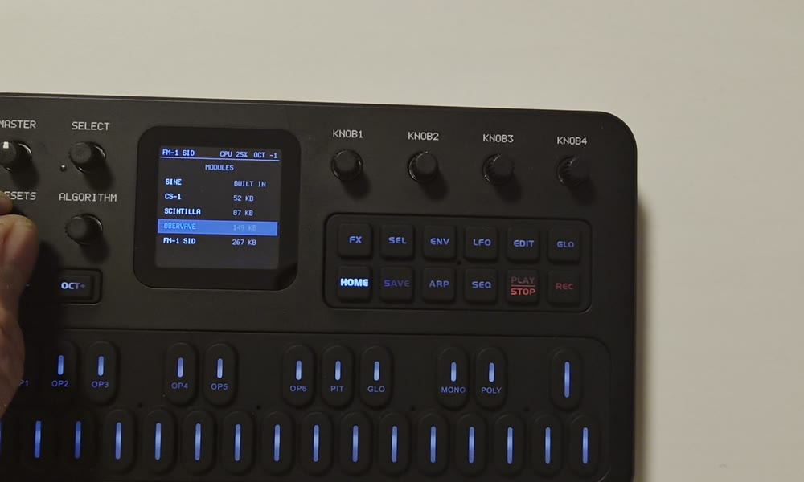
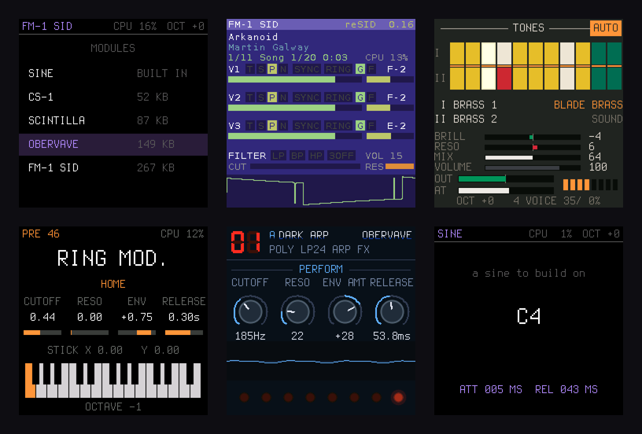

<p align="center">
  <picture>
    <source media="(prefers-color-scheme: dark)" srcset="docs/media/fm1-dock-light.svg">
    
  </picture>
</p>

<p align="center"><b>One firmware for the M-VAVE FM-1. Many synths.</b></p>

fm1-dock is installed once. The synths are modules in flash: hold HOME, pick another one, play. No reinstall.
Deploy your own module over USB in seconds, and when something goes wrong, the log, the crash record and the
render load are one click away in the browser.

<p align="center"></p>

**[The page](https://joakimeriksson.github.io/fm1-dock/)**: the video, the console (status, log, deploy and probes over
WebMIDI), the emulator in the browser, the module interface and the protocol.

## What's in the dock

<p align="center"></p>

| | by | |
| --- | --- | --- |
| **CS-1** | twochannels | A CS-80-style synthesizer: two layers, its tone bars, effects, user presets, velocity and aftertouch from the keys. |
| **Scintilla** | Joakim Eriksson | The 1981 Elka Synthex: all 80 factory patches, the laser harp ("Ring mod.") among them. |
| **OberVave** | zvenson | A 4-track analog poly with arpeggiator, sequencer and effects. |
| **FM-1 SID** | Joakim Eriksson | C64 music: a cycle-exact 6510, reSID and an own SID model; tunes, subtunes, songs saved to banks. Deployed next to the others (it is too big for the package). |
| **SINE** | built in | Dinghy's 4-voice sine: the fallback when a module fails, and the smallest module to copy. |

## Install

Download `harbor.fwsc` from the [releases](https://github.com/joakimeriksson/fm1-dock/releases) (the files still carry the
old name, harbor, until the code is renamed) and install it over USB:

```sh
pip3 install mido python-rtmidi
python3 tools/fm1_install.py harbor.fwsc        # asks before it writes, restarts into fm1-dock
```

Back to any other firmware, or to the official one, with the [FM-1 Firmware Hub](https://fm1.designburgapps.com) in
Chrome or Edge: fm1-dock answers the hub's updater like every firmware there. Installing a new fm1-dock keeps your
deployed modules, settings and presets. Installing firmware is at your own risk.

## Play it

| | |
| --- | --- |
| **HOME** | the picker (a module that owns the whole panel: hold HOME alone for 1.5 s) |
| **SELECT / PRESETS** | move in the picker; **PLAY**, **SEL** or **HOME** load the module |
| **OCT+ at power-on** | safe start: the sine only |
| **OCT− at power-on** | the USB rescue: no sound, only the updater |

fm1-dock starts whatever played last. A module that crashes twice in a row is skipped at boot until you pick it again;
one that renders slower than real time is stopped and the sine plays, so USB and the updater keep working.

## Your own module

A module is a table of functions (`render`, `note`, `ui`, `draw`, ...) at the start of its image; it links against
nothing of the host's, and the host checks its header, ABI and CRC before anything of it runs. Start from
[modules/sine/sine.c](modules/sine/sine.c) (about 150 lines); [firmware/harbor/hb_module.h](firmware/harbor/hb_module.h)
has every call the host gives it.

```sh
python3 tools/hbmod.py modules/mysynth                                   # -> build/modules/MYSYNTH.hrbr
uv run --with python-rtmidi tools/harbor.py deploy build/modules/MYSYNTH.hrbr   # into the FM-1, running
uv run --with python-rtmidi tools/harbor.py modules | logs | select NAME | delete NAME
```

Or drop the `.hrbr` on the [console](https://joakimeriksson.github.io/fm1-dock/#console). A module has 272 KiB of RAM,
16 KiB of RAM code, a settings record and flash banks for presets; a deploy file is up to 272 KiB.

**Probes** measure the real chip: a small C program run once from RAM inside fm1-dock, its result back as JSON, the
same probe in [fm1-emu](https://github.com/joakimeriksson/fm1-emu) for comparison:

```sh
tools/probe.py run probes/timing.c --on emu,fm1
```

## Build it

You need Linux on x86-64 (or macOS / Windows with Docker or WSL), Python 3 with Pillow, the JieLi toolchain and three
files of the JieLi AC79 SDK:

```sh
pip3 install Pillow mido python-rtmidi
tools/get_toolchain.sh                      # JieLi's clang for the chip, to ~/.jieli/toolchain
git clone --depth 1 --branch AC79NN_SDK_V1.2.1_2023-12-13 \
    https://gitee.com/Jieli-Tech/fw-AC79_AIoT_SDK.git ~/fw-AC79_AIoT_SDK
./build.sh --modules cs1,scintilla,obervave   # -> build/harbor.fwsc (fails on what would brick the FM-1)
```

In the emulator, without an FM-1 (the same package, and with `--flash` the same flash: deployed modules included):

```sh
fm1-live --fwsc build/harbor.fwsc --flash flash.bin
tools/harbor.py emu --fwsc build/harbor.fwsc --deploy fm1sid.hrbr --ms 6000
```

The platform underneath is Dinghy's: [docs/API.md](docs/API.md) (everything `platform.c` gives), [docs/RULES.md](docs/RULES.md)
(the chip's rules and what the build checks), [docs/MAKE-IT-YOURS.md](docs/MAKE-IT-YOURS.md).

## Credits

fm1-dock, FM-1 SID and Scintilla: Joakim Eriksson. OberVave: zvenson. CS-1: twochannels. reSID: Dag Lem.
fm1-dock stands on [Dinghy](https://github.com/zvenson/dinghy) (zvenson), on the platform of
[Felucca](https://github.com/hugelton/Felucca) (Leo Kuroshita, Hügelton Instruments) as [SLOOP](https://github.com/isod89/sloop-fm1)
(isod89) carries it. The keys' force sensing comes from Velo, by way of CS-1.

GPL-3.0-only: you may change and share it, and whoever gets your firmware gets its source. Details and third-party
parts in [LICENSING.md](LICENSING.md). Not affiliated with M-VAVE.
